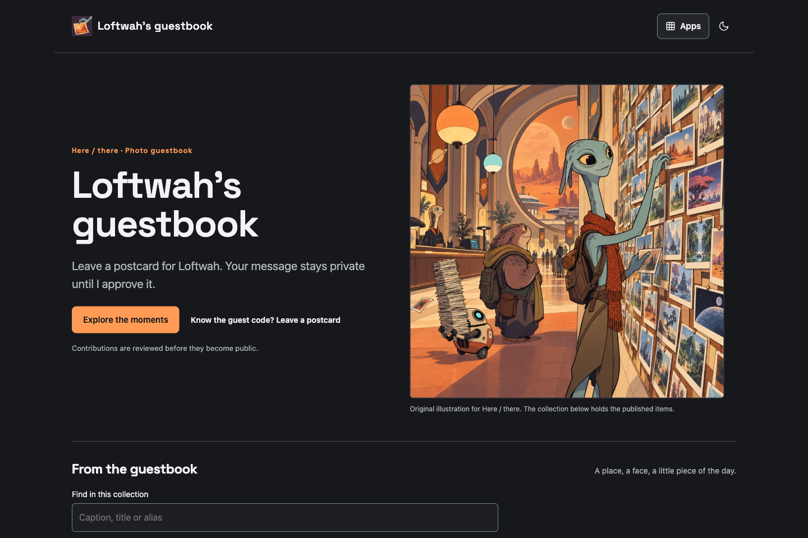

# Here / there

Here / there collects photos and guest postcards for an owner to review before publishing. Visitors browse approved moments; owners control moderation and revoke controlled media at its source. It runs independently and provides approved public items to Linkarooie. MIT.

[Development commands and source ownership](ENGINEERING.md).

`pnpm install --frozen-lockfile; pnpm check; pnpm dev`. Deployment: provision isolated D1 and private R2, set `OWNER_API_TOKEN` with Wrangler secret input, then `pnpm deploy` from the exact reviewed pushed main. The guarded release checks/builds, applies pending forward D1 migrations from `migrations/` to the explicitly selected production `DB`, rechecks source identity and only then uploads. No GitHub Actions. Secrets never belong in source.

Versioned contract: `app.manifest.json`. Generic provider API: `/api/items` and `/api/items/:id`, contract 1; only currently public approved items are returned. Media and item queries send no-store, so source revocation applies on the next controlled request. A downloaded copy cannot be recalled.

Owner entry is `/owner`. This instance sets `OWNER_STUDIO_URL` to its existing Cloudflare-protected Composer editor, selecting this app. The redirect creates no app session and grants no API permission. Independent installations omit that optional variable and retain the local runtime-credential studio. Public registration is not added. Public browsing works without Composer. Owner photo uploads remain invitation/owner-only. An optional guest postcard path is closed by default: the owner can enable it in configuration, and the public puzzle code `hunter2` permits new pending postcards only. It never signs a guest into the owner studio. No anonymous multi-tenant promise. Composition mounts this service under its manifest route. Data remains with the app, never inside Composer.

Actual production public UI, captured 18 October 2026 at source `1ea82adbafac109be3a13d30071b39fddb925562`. [Phone capture](docs/images/public-collection-20261018-phone.png) · [Capture provenance](docs/images/capture-20261018.json).

## Public project standard

Reviewed 13 October 2026. The app supplies saved reader dark/light themes, native app navigation with Ctrl/Cmd+K and ordinary links, visible keyboard focus, phone layouts, favicon/touch icon and page-specific social metadata. Original generated App Composer artwork is retained with its prompt; functional icons remain vectors. These features do not widen signup, owner access or disclosure permissions.

Contributions: [Contributing](CONTRIBUTING.md), [Code of Conduct](CODE_OF_CONDUCT.md), [Security](SECURITY.md), [Accessibility](ACCESSIBILITY.md). Physical-device, screen-reader and full platform sharing acceptance remain distinct from browser checks.

Public collections include caption/alias search, a clear app explanation and original app thumbnails in navigation. When mounted, the reader theme and links stay with Composer; standalone themes remain app-owned. The invited studio and review permissions are unchanged. Review: 14 October 2026.

## Health and optional usage

Reviewed 14 October 2026. `GET /healthz` (or the declared mount plus `/healthz`) returns public liveness and exact source revision. It does not query storage, inspect credentials or prove a full user journey. `HEAD` is supported; other methods return 405.

Optional server-only daily counts use `USAGE_ENDPOINT` (an explicit HTTPS app-scoped endpoint) and `USAGE_TOKEN` (a write-only runtime secret). Both are absent by default, so forks remain independent. The copied MIT publisher derives from App Composer `lib/usage/publisher.mjs`; it is owned and deployable here, without a Composer package or Woodhouse runtime dependency. Failure or a 1.5-second timeout drops a count without blocking the app; there are no retries. Successful public home-page opens, original contribution-page opens and newly committed pending guest postcard receipts can be published. Receipt counts are not publication or unique-person counts; owner moderation is not counted. No visitor, URL, referrer, entered text, identity, profile, filename or passphrase is sent. `X-Composer-Verification: 1` excludes synthetic release probes.

The launch operator enables its own instances through Wrangler secrets; do not copy those secrets into a fork. The public [app activity](https://composer.loftwah.com/activity) explains retention, limits and missing-count/bot caveats.

Add `?vitals=1` to the public page, then open “Page performance” for local LCP/INP/CLS measurements. Values apply to this load only; unsupported metrics say unavailable. The self-hosted standard `web-vitals` 6.2.3 bundle and Apache licence/provenance are retained. No values, element attribution or page data are uploaded or persisted. Developer console links stay public and do not print app contents.

Original editorial presentation, reviewed 14 October 2026: app-specific illustrated hero and sharing artwork, responsive 600/1200px WebP sources, reserved image dimensions, clear collection/story sections and native browse/contribute actions. Illustration is labelled separately from published contributions. Mounted social URLs resolve inside the app mount. Owner titles, introductions, layouts, moderation, data and configuration contracts are preserved. Asset provenance and optimisation are recorded beside each derivative.

## Optional guest postcards

The owner sets `guestAccess` to `postcards` (or back to `closed`) through the existing configuration contract. Guests open `/contribute`, write up to 160 characters and an optional 60-character alias, confirm consent, and send a browser-rendered PNG postcard. This is a visual contribution with accessible caption/alias metadata, not a new message database or a verified identity. The puzzle code is intentionally public; authority comes from the narrow server route. No owner credential or guest session is issued.

`POST /api/guest-postcard` accepts only code/caption/author/consent/png from the same origin, validates/sanitises the PNG (100 KB, 1200 × 900 maximum), and creates a new random pending item. The existing provider, media visibility, owner review and revocation paths apply unchanged. A guest cannot publish, modify/delete another entry, export, change settings, see pending/private media or use owner uploads. Owner closure/pause and queue/collection caps are rechecked atomically at insertion; storage failure cleans the generated object where possible and never exposes it publicly.

Bounds: six attempts per IP-derived connection bucket per 15 minutes, two valid submissions per bucket, eight admitted submissions globally per UTC day, sixteen pending review items and the existing 200-item gallery cap. Failed storage/admission attempts can consume a daily slot; retries are explicit. These are abuse/storage bounds, not distinct-person counts. Existing owner photos/data/configuration stay in their app-owned D1/R2; no schema migration is needed. The default and earlier clients keep submissions closed unless the owner explicitly activates them. Browser/production qualification and Composer source-pin promotion remain separate from source tests.

## Public sharing and link presentation

MP direction, 16 October 2026: links use no underlines and retain visible keyboard focus. Page, Open Graph and X titles/descriptions agree; the app serves an explicit large-image card with dimensions, type and alt text. The normal release checks live public HTML and JPEG dimensions with a marked Twitterbot user-agent probe. Actual X rendering is a separate observation; a probe alone does not establish it.

The shared header keeps theme switching as a quiet current-mode sun/moon icon. Preserve the stable Dark theme accessible toggle name, pressed state, keyboard focus, 44px target and existing saved-preference key. Keep the secondary control class so light-theme primary-button rules cannot override its foreground.

## Shared Apps launcher

The committed `public/brand/launcher.js` and `launcher.css` follow Composer's maintained launcher contract. The controller is generated from Composer's strictly checked `src/browser/launcher.ts`; app destinations, theme keys and gallery filters stay local. Review and copy updates with Composer's explicit `pnpm ui:assets --check|--write /absolute/this-checkout`, then run this app's checks and release independently. No runtime Composer asset dependency or automatic update is added.

Family typography and launcher refinement, reviewed 18 October 2026: headings use the selected self-hosted Latin Space Grotesk variable font; CSS and preload name the same versioned local asset. The Linkarooie launcher thumbnail uses the reviewed curator crop. Superseded assets remain available. Source and byte provenance: [`public/brand/family-assets-20261018.md`](public/brand/family-assets-20261018.md).

Identity/sharing refinement, 18 October 2026: the app now serves dated optical PNG icons and purpose-first share cards derived from its existing illustration. All five launcher thumbnails are dated local copies. Prior immutable assets and owner configuration are retained; provenance and exact hashes are in `public/brand/identity-sharing-20261018.json`.

## Owned Guestbook release settings

The root production configuration explicitly selects this app’s existing account and `RESOURCE_ENVIRONMENT=production` for the authenticated owned-Guestbook contract. Without both resource identity variables the feature remains off in app code; public metadata never grants write permission. Composer must present the matching workspace/account/environment/source/target proof and its server-only app credential. Existing owner configuration, photos and moderation remain app-owned.

The named `preview` environment is intentionally unprovisioned: resource variables are empty, routes and Workers.dev are disabled, and D1/R2/service bindings are explicitly empty. It cannot inherit the production resources. An operator must select distinct preview storage and runtime identity before enabling that environment; default production release commands explicitly select root `wrangler.jsonc` with `--env=`.

`pnpm deploy` runs `pnpm wrangler d1 migrations apply DB --remote --config wrangler.jsonc --env=` after checks/build and a source recheck. Migration failure aborts before upload; another full source/config/ref recheck follows migration. Migrations `0001.sql` and `0002_owned_resources.sql` are forward-only and idempotent (`IF NOT EXISTS`): the second adds isolated resource/configuration/operation/item tables without copying or altering legacy photos/settings/media. Code rollback must retain these tables and their data; never run a destructive down-migration.

## Approved content portability and recovery limits

The authenticated resource API supports a bounded portable file at `GET /api/resources/:id/portable`. It includes the active declared configuration, exact build/configuration/source identities, up to eight original approved contributions, their sanitised PNG bytes and SHA-256 digests, and explicit included/eligible counts. Missing media or more than eight eligible contributions makes coverage partial. Pending, hidden, deleted and previously restored contributions, credentials, global owner photos, other apps, Worker deployments, DNS, cost metrics and third-party data are excluded. No new licence is granted; the operator must retain consent and confirm permission to copy.

`POST /api/resources/:freshId/restore` accepts only `{operationId, confirmRights: true, manifest}` through the existing server-authenticated workspace/account/environment/source/target boundary. It requires the current same app build and the original live source configuration, version, approved item revisions, metadata and PNG digests. It never overwrites an existing resource, item or tombstone. New resource/item identities start private and paused, with a staged configuration, no active publication and pending contributions. The file supplies data, never authority. This is not offline or cross-account disaster recovery and cannot recover a lost source database.

Forward migration `0003_portability_lineage.sql` retains original source lineage. Later approval, public/provider item reads and both public and authenticated copy-media requests require that exact original approved item revision and visible active source configuration. Hiding/deleting the source, changing its configuration, or losing/changing its PNG denies copied media; hide followed by reapproval does not authorize an older copy. A private restore cannot subsequently revive a revoked source through publication or an old configuration URL. Downloaded files outside these controlled routes cannot be recalled.

Keep the operation identity when a restore response is unknown. `GET /api/resources/:freshId?operation=:operationId` reconciles the app-owned durable receipt; the same confirmed request returns its original acknowledgement. Lost acknowledgements retain private scoped media rather than deleting possibly committed content. R2 and D1 do not share a transaction: interrupted/unknown object writes may retain inaccessible private objects pending operator investigation. A refused final source/version guard cleans definitive unused copies. No automatic retry, complete backup, point-in-time recovery, retention guarantee, zero-loss or downtime promise is made. Apply all forward migrations before running this source; code rollback must preserve lineage and tombstones.

## Contribution invitation contract

Each owned Guestbook publishes a small, versioned answer at `GET /r/:resource/api/invitation`. It names the current active configuration, the exact contribution page and collection page, the supported postcard limits, and one state: `open`, `paused`, `closed` or `full`. `accepts` is true only for `open`. The response never contains the guest code, an owner credential, media or submission text.

The state follows the resource's current active configuration, not a historical activation path. `full` means the pending queue (16) or the non-deleted item cap (200) has been reached. The public `/contribute` page uses the same state, so it does not show a form that would immediately fail. A composed app can therefore offer the real form only while this Guestbook accepts postcards, and explain paused, closed, full or unreachable states without inventing a second comment system. The app manifest declares `guestInvitation` version 1; Composer's promotion boundary validates that exact descriptor.

## Prepared private enquiry API

The app-owned private brief form and inbox are implemented behind explicit closed-by-default resource scopes. No contacts, email, uploads, notifications or public enquiry feed are added. See [the exact routes, private-delivery consent, finite bounds and retention](docs/private-enquiries.md). Local fictional Worker/browser qualification does not establish deployment or complete audience automation.
